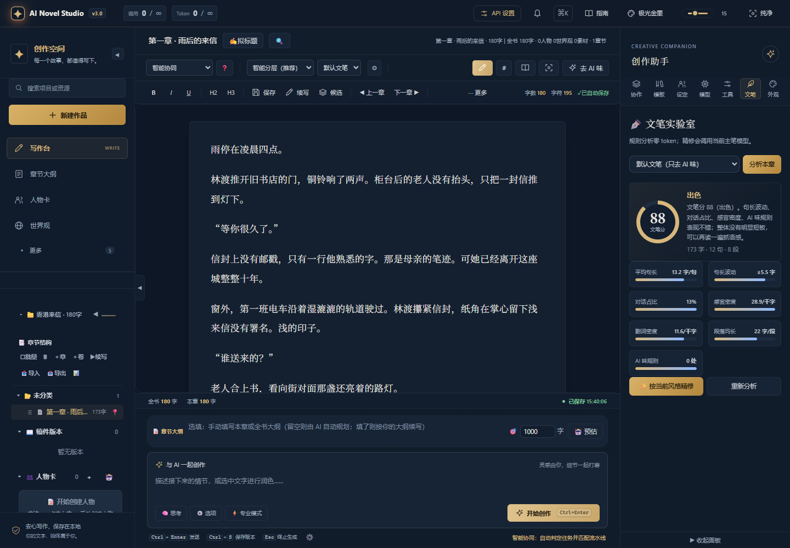
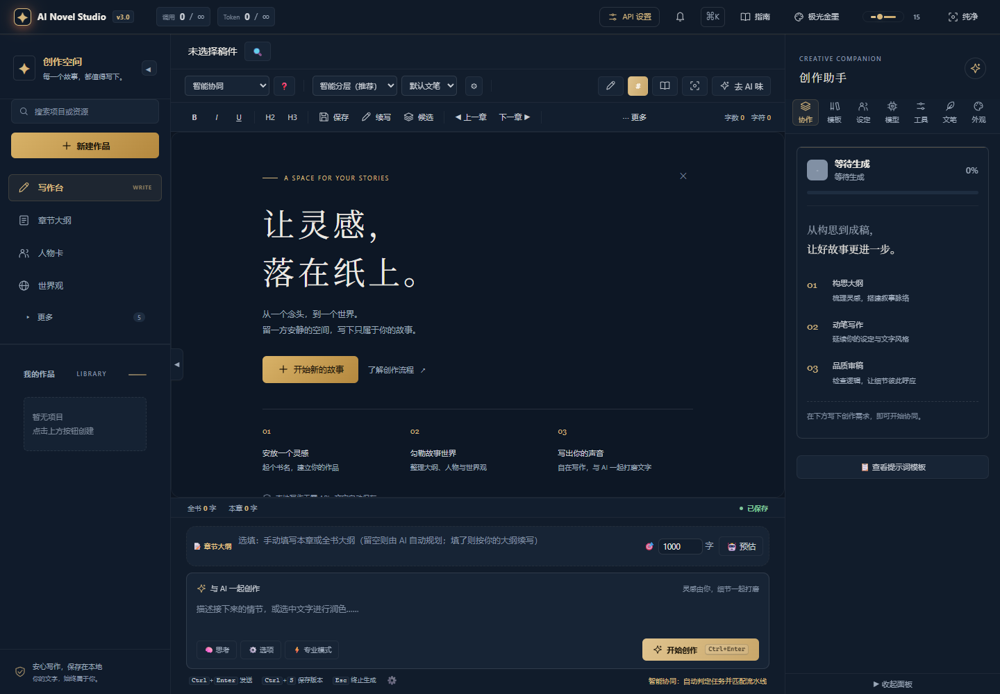
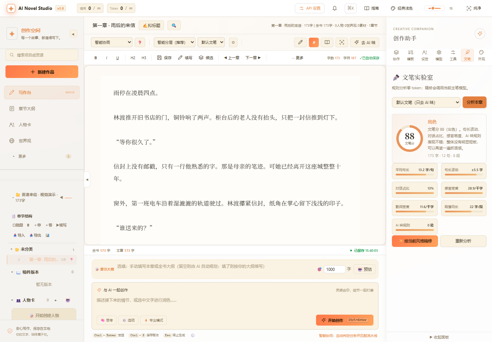
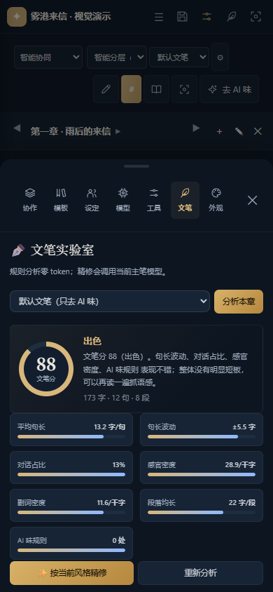

# 3.0 写作空间视觉更新

日期：2026-10-23。公开仓库发布独立 3.0 项目的后端、前端、配置模板、启动脚本与文档。

## 设计方向

保留极光金墨的深蓝与暖金，让作品成为视觉中心。暖金用于当前导航、主要行动与分析结果，辅助文字使用清晰的灰蓝色。界面使用系统无衬线字体，正文和主要标题使用本地可用的中文衬线字体，不新增字体下载依赖。

首页以「让灵感，落在纸上」和三个创作步骤引导开始；标题、创作设置、编辑工具分别排列。右侧助手使用带文字的导航，文笔报告保留指标与建议。手机端压缩工具区，顶部羽毛笔按钮打开助手。

## 源码梳理

工作区保留 1.0、2.0、3.0 三套独立程序。本轮实现集中于 3.0，核心链路为：

| 层 | 位置 | 职责 |
| --- | --- | --- |
| 程序入口 | `cmd/server/main.go` | 配置、SQLite、日志、模型池、限额、备份、HTTP 服务 |
| 接口 | `internal/interfaces/api/` | 项目与章节管理、设定资源、SSE 生成、文笔分析、导出 |
| 创作编排 | `internal/domain/pipeline/`、`roles/` | 上下文、角色提示词、生成、审校、风格与字数规则 |
| 基础服务 | `internal/infrastructure/` | SQLite 仓库、模型适配、检索、限流、日志 |
| 前端 | `web/index.html`、`web/js/`、`web/css/` | 普通脚本模块、双模式编辑器、页面路由、主题和响应式布局 |

## 修复的实际问题

- 额外闭合标签提前结束主布局，助手依靠绝对定位覆盖在编辑器上。现在三个区域处于同一个布局容器。
- 空章节也显示欢迎引导，妨碍直接输入。现在引导只服务未选项目的状态。
- 多个 Markdown 选择器缺少主题前缀，使纸墨主题颜色影响深色正文。现在每个主题分别限定作用范围。
- 主题保存为 JSON，首屏脚本按普通字符串读取。现在兼容两种存储格式。
- 手机助手复制 HTML 产生重复 ID，文笔结果可能渲染在隐藏的桌面副本里。现在移动原节点并在关闭后恢复。
- 正文内外两个边框造成重复卡片；手机悬浮助手按钮覆盖生成按钮。现在使用单一正文表面，手机顶部提供助手入口。

## 验证

使用隔离的临时 SQLite 数据库和虚构的《雾港来信》演示内容，未调用付费模型生成或精修。

- `go test ./...`：全部通过。
- 35 个前端普通脚本通过语法检查。
- 无界面 Chromium 测试覆盖新建项目、空章节编辑、自动保存到 SQLite、规则文笔分析、命令搜索、主题恢复与全部 9 个功能页面。
- 检查 1920、1440、1280、1024、900、768、390、360 像素宽度，页面没有横向溢出，生成按钮保持在视口内。
- 检查手机文笔分析结果显示、面板 ID 唯一，以及返回桌面后的面板恢复。
- 检查 8 个主题的切换与 SVG 图标的媒体类型；自动化交互过程中没有 JavaScript 运行错误。
- 使用实际 CDN 模块初始化 Tiptap，验证富文本输入、数据库保存、文笔分析与阅读预览。

富文本模块仍使用项目原有的 esm.sh CDN，断网时回退 Markdown。AI 生成和模型精修的质量取决于配置的模型，本轮没有以付费调用验证。

## 预览

